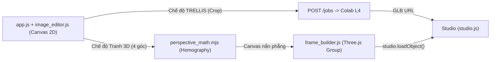

# Museum Crop & 3D Frame Mode

## Overview

Bổ sung hai tính năng thuần frontend trong `web_app/frontend/` (không sửa backend Colab `server.py` hay `trellis/`) để xử lý hai trường hợp chụp hiện vật bảo tàng:
1. **Crop chữ nhật** trước khi bấm **Process** (cho 1 ảnh, nhiều góc, và hàng loạt) để loại bỏ khung tủ kính/đế gỗ trước khi `rembg` + `TRELLIS` tạo 3D.
2. **Chế độ Tranh 3D (0đ GPU)** cho phép kéo **4 góc** quanh bức tranh/ảnh phẳng để nắn phẳng phối cảnh bằng homography thuần JS, dựng khung tranh 3D có viền nổi + texture nét, nạp thẳng vào `Studio` qua `loadObject()` để chỉnh mm và xuất `.GLB` / `.STL`.

## Goals

| # | Goal | Priority |
|---|------|----------|
| 1 | Cắt bỏ tủ kính/đế tủ bằng khung Crop chữ nhật trên trình duyệt trước khi gửi `POST /jobs` | P1 |
| 2 | Dựng khung tranh 3D từ 4 góc nắn phẳng trên trình duyệt (xuất `.GLB` & `.STL` không cần Colab) | P1 |
| 3 | Tái sử dụng `Studio` (`setContent` / `loadObject`) cho cả mesh TRELLIS và khung tranh 3D | P1 |

## Architecture & Extension Trace

- **Boundary:** `Studio.setContent(content, options)` và `Studio.loadObject(object3D, options)` trong `web_app/frontend/studio.js` là điểm nối dùng chung cho mọi nguồn mô hình 3D (GLB từ Colab, GLB từ máy, mẫu thử, và khung tranh 3D). Nếu sau này thêm nguồn 3D thứ 3 (như phù điêu heightmap), chỉ cần dựng `THREE.Group` và gọi `studio.loadObject(...)` mà không sửa logic gizmo, undo/redo, đo mm, hay exporter.

## Phases

| # | Phase | Status |
|---|-------|--------|
| 1 | [Phase 1: Perspective Math & Frame Builder](./phase-01-start.md) | Pending |
| 2 | [Phase 2: Crop & 3D Frame Editor UI](./phase-02-crop-and-frame-ui.md) | Pending |
| 3 | [Phase 3: Docs & End-to-End Verification](./phase-03-docs-and-verification.md) | Pending |

## Dependencies

- Không thêm thư viện ngoài hoặc bước build npm; giữ nguyên ESM CDN `three@0.180.0` trong `web_app/frontend/index.html`.
- Backend `web_app/backend/server.py` và `web_app/colab_backend.ipynb` giữ nguyên, không đổi API contract.

## Success Criteria

- [ ] Ảnh tủ kính (`baotang2.jpg`) sau khi Crop gửi đúng kích thước vùng cắt lên `POST /jobs` và tạo được hiện vật bên trong (không còn vỏ hộp kính đen).
- [ ] Ảnh tranh (`baotang3.jpg`) ở chế độ **Tranh 3D** nắn phẳng 4 góc, dựng khung 3D có viền nổi + texture rõ và xuất được `.GLB` + `.STL` khi chưa kết nối Colab.
- [ ] `node --test tests/*.test.mjs`, `node --check` trên toàn bộ JS/MJS, và `ak plan validate` đều pass.

<!-- slug: museum-crop-and-frame-3d -->
